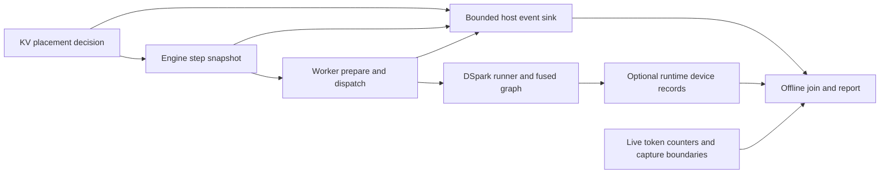

# DPLB diagnostics design

Status: proposal, implementation not started. Tracks
[serving issue #325](https://github.com/hw-native-sys/pypto-serving/issues/325).
No serving policy, default, runtime, or kernel changes are included in this document.

## Goal and implementation order

Explain the chain from **placement decision -> scheduled group load -> device cost -> service outcome**.
The initial target is DeepSeek V4 DSpark. Preserve its async execution, prefix reuse, and fused bootstrap
and decode paths while observing both DPLB disabled and enabled.

Implement in three increments:

| Increment | Deliverable | What it establishes |
| --- | --- | --- |
| P0 | Placement records, dispatch load, output accounting, and a joined report | What the policy decided and what work the serving stack submitted |
| P1 | Sampled device timing joined to those records | Whether actual attention cost and the slowest group improved |
| P2 | Cost-model evaluation and optional shadow choices | Which features predict cost; whether a proposed policy merits an A/B experiment |

P0 must ship independently. It does not claim to measure per-group device attention time. P1 requires
a small cross-stack feasibility prototype before promising a timing API or overhead bound.
Changing the DPLB algorithm, migrating live KV, and implementing the
[proposed cost score](dplb-cost-policy-proposal.md) remain separate work.

## Existing integration points

The current serving checkout already provides the following boundaries:

| Code | Existing information | Proposed use |
| --- | --- | --- |
| `serving/memory/kv_cache.py` | Candidate feasibility, prefix hits, owner, logical load, ranking and rotating ties | Capture the actual placement inputs and committed result |
| `serving/memory/reservation.py` | Reservation, adoption and rollback | Describe early ownership without counting adoption as another admission |
| `serving/sched/scheduler.py` | `ScheduledRequest`, cache partition, prefill flag and token counts | Snapshot planned work before optimistic scheduler advancement |
| `serving/engine/async_engine.py` | `step_id`, command enqueue, output application and stale-result handling | Attach stable correlation and distinguish submit from confirmed output |
| `serving/server/ipc.py` | `StepCommand.step_id` and `StepResult.step_id` | Carry a compact optional capture token |
| `serving/server/serving_worker.py` | Owned buffer slot, prepared batches and pending outputs | Relate an engine step to its actual worker dispatches |
| `model/deepseek_dspark/npu_runner.py` | Prepared request/group mapping, descriptors and pending L3 handles | Record execution layout and map runtime invocations |
| `tools/profile/` | On-demand capture, per-process fragments, trace merge | Reuse control and host trace presentation |
| `observability/logger.py` | Live output counters and token-interval sum/count | Preserve duration-based outcome statistics for unfinished requests |

The selected `95c8280` serving base used for the previous benchmark has no reservation module.
Use the same event contract through its allocator/scheduler admission paths. Do not copy the newer
reservation implementation into that version just to instrument it.

The current `ProfileRecorder` serializes and writes records under a lock on the calling thread.
Detailed DPLB records need a bounded asynchronous sink; calling that writer for every request in every
step would add avoidable work to the scheduler. The existing generic profiler can still carry small
spans and correlation IDs.



## Observation semantics

### Three different load views

Never merge these quantities into one unlabeled `sequence_length` or `batch_size`:

1. **Policy load:** request ownership and the logical lengths used by admission. It includes the
   complete prompt during chunked prefill and can include reservations that have not executed yet.
2. **Scheduled load:** requests and token extents in a particular `StepCommand`. The engine may have
   advanced positions optimistically to pipeline speculative work.
3. **Executed load:** the valid rows and anchors consumed by a particular device invocation. Fused
   device preparation can resolve values after the host prepared its next step.

Every snapshot declares `length_source`: `policy_logical`, `scheduler_planned`, `worker_mirror`, or
`device_confirmed`. An unavailable executed length stays unavailable; P0 must not add a per-step D2H
just to label a host estimate as exact. Completion corrections are appended as separate records.

Policy length, computed prefix length, full-history extent, compressed-cache extent, and reserved
physical capacity are distinct fields. Capacity also stays separate for each KV family; sums of
heterogeneous page counts are not a meaningful capacity measurement.

### Group and request identity

The topology manifest records `group_id -> logical ranks -> physical devices`. Obtain this mapping
from the executor layout and device placement, not from the host replica count. DP4/EP16/TP4 has four
logical DP/cache groups containing four TP ranks each even though one overlapped worker owns them.
The schema also supports TP1.

Use these keys:

| Key | Purpose |
| --- | --- |
| `run_id`, `replica_instance_id` | Distinguish processes, replicas and worker restarts |
| `capture_id` | Distinguish repeated start/stop windows |
| `request_uid`, `admission_epoch` | Distinguish request-ID reuse and ownership reacquisition after preemption |
| `decision_id`, `attempt_id` | Relate allocation attempts, fallback and rollback to a committed admission |
| `step_id`, `dispatch_ordinal`, `stage` | Distinguish multiple prefill/bootstrap/decode invocations inside one command |
| `buffer_slot`, `slot_generation` | Distinguish successive uses of the same async slot |
| Runtime invocation ID, rank and clock domain | Join an actual runtime submission to device records |

Slot generation is a diagnostic ownership key, separate from DSpark's existing per-request drafter
lease/state generation. A buffer slot or runtime callable ID alone cannot identify an invocation.

## P0: host records and output accounting

### Placement and lifecycle

Instrument the existing ranking and prefix-search pass rather than running another allocation or
prefix lookup to explain it. Emit the result only after mutation succeeds. A failed attempt gets an
explicit failure/rollback record and contributes no admitted load.

`admission_decision` contains:

- Request/attempt identity, policy name/version, enabled state, prompt length and incoming policy load.
- Per group: request count, sum/max policy lengths, feasible status, capacity rejection reason,
  prefix-hit length when evaluated, actual lexicographic ranking tuple, and rotating tie position.
- Selected group, winning prefix extent, committed load and a reason such as `long_kv_load`,
  `short_request_count`, `count_only`, `prefix_longest`, `prefix_equal_hit_tiebreak`, or `explicit_owner`.
- Provenance for unavailable candidate fields. Do not perform additional prefix scans to fill them.

The current heuristic has a tuple ranking, not a universal scalar score. Export that tuple unchanged.
Keep the longest-prefix preference and allocator feasibility checks explicit. A later capacity-driven
cold retry must not be mislabeled as the original prefix choice succeeding.

Use compact `owner_acquired`, `owner_released`, `reservation_adopted`, `reservation_rolled_back`, and
`request_terminal` events. Record release reasons, including preemption and cancellation. Maintain
separate policy-owner and worker-resource retirement states when they occur at different times.
A preempted request that acquires another group starts another admission epoch.

At capture start, emit a baseline snapshot of already-owned requests and current group policy loads.
Their original admission is `preexisting`, not reconstructed history. A maximum-length reduction
after release must be visible; do not maintain a max that only ever increases.

### Step planning, preparation and completion

Create `step_plan` after `_build_step_command` and before `advance_after_schedule`. Freeze its small
scalar/request-ID snapshot; never retain a reference to mutable `Request` objects for deferred writing.

For each group, record:

- Planned prefill and decode members, their admission epochs and length sources.
- Count, sum, max and fixed length buckets. Detailed membership is limited to captured steps.
- Prefill query tokens, planned verify query rows, and subsequently confirmed draft/accepted counts.
- Shape/layout key, physical row extent, valid request/query rows when known, block-table extent,
  and per-family logical cache coverage when available from existing host metadata.

Bucket definitions are part of the manifest. An initial set of upper bounds is 4K, 16K, 64K, 128K,
256K, 512K and overflow. Do not export per-request lengths as Prometheus labels.

Record `dispatch_prepare`, `dispatch_submit`, `dispatch_complete`, `step_output_applied`, and
`step_discarded`. A mixed step can have more than one invocation; bootstrap gets its own stage label.
Use the worker's prepared group mapping to confirm the plan-to-dispatch relationship. Keep host
queue, preparation, submit, reclaim and output-application durations separate from device duration.
`pending.dispatch.wait()` measures host waiting, not per-group attention compute.

The pending work object owns an immutable capture token and any timing buffer until normal reclaim.
On cancellation or preemption, keep that association until the in-flight invocation completes or is
retired. Late output for a discarded step remains diagnostic output for that step; it must not update
request success counters or be reassigned to a new owner.

### Compact schema example

The following values illustrate the schema; they are not measurements:

```json
{
  "schema_version": 1,
  "event": "dispatch_submit",
  "capture_id": "c1",
  "replica_instance_id": "r0",
  "step_id": 240,
  "dispatch_ordinal": 1,
  "stage": "decode",
  "buffer_slot": 0,
  "slot_generation": 120,
  "length_source": "worker_mirror",
  "groups": [
    {
      "group_id": 0,
      "member_ranks": [0, 1, 2, 3],
      "request_count": 3,
      "sum_context_tokens": 196608,
      "max_context_tokens": 131072,
      "valid_query_rows": null,
      "valid_query_rows_status": "device_prepared"
    }
  ]
}
```

### Service outcomes for a duration window

Take cumulative counter/histogram snapshots at the declared window boundaries. Count emitted output,
not proposed speculative tokens, on every update even if its request has not finished.

```text
observed_token_interval_mean = delta(inter_token_latency_seconds_sum)
                            / delta(inter_token_latency_seconds_count)
generation_throughput        = delta(generation_tokens_total) / measured_window_seconds
```

These quantities are not inverses. Exclude first tokens from interval counts. If one speculative
update emits several tokens, count the elapsed interval once and use zero intervals for the other
tokens, matching current `observability/logger.py` semantics. A zero interval is valid; do not drop it.
The sum can exceed wall time because requests overlap.

Keep preemption/queue delays inside the observed gap between emitted tokens. Waiting for a next
token that has not arrived by window end is unobserved, not zero. Report that limitation together with
open request counts, unfinished decode count, and time since the last output for open decode requests.
Do not add those censored tails to the mean without defining a different estimator.

Always retain global TTFT, completed-request TPOT, throughput, prefix hits, accepted tokens, errors,
preemptions and request accounting. Label completed-request statistics separately. If per-group
output attribution is added, use the emitting step's owner/epoch, not the request's latest owner;
cross-preemption intervals require an explicit label. Never derive per-group TPOT from global rate.

## P1: device timing without changing the execution graph

The serving profiler currently supplies host spans. The pinned runtime documents ChipSwimlane task
records, local device-wall timing and selective task-timing slots. These are potential inputs, not an
already implemented serving API for per-group attention.

Start with a bounded diagnostic capture using existing runtime task records. Publish a manifest that
maps runtime program/task instance and parent scope to `layer_id`, `attention_kind`, `model_part`, and
semantic stage. The map must distinguish main-model attention, bootstrap and drafter SWA. Kernel-name
substring matching alone is insufficient for a fused graph with shared helpers and repeated layers.
If an instance cannot be mapped unambiguously, retain it as unknown and publish the coverage gap.

Define an `attention_block` boundary consistently: attention-side HC preprocessing, projections,
attention/cache/indexer/compressor work, output projection and attention-side postprocessing, excluding
MoE/FFN. Retain optional primitive breakdowns under this envelope. HCA/CSA blocks can contain a
sliding-window component, so do not count that component again as a separate SWA model layer.
Alternative boundaries must have different schema names and cannot share a timing fit.

For each sampled layer/group/rank, retain local duration, semantic boundary, timing source and coverage.
Define:

```text
slowest_rank_attention_duration(group) = max(local_rank_attention_duration)
group_imbalance_ratio                 = max(group_duration) / mean(group_duration)
```

The first is a comparison of durations, not a synchronized cross-device start/end envelope. The
second is undefined when the mean is zero. Report both all configured groups and logically nonempty
groups, together with the active mask. Preserve measured empty-group overhead; a padded fixed graph
can do work even with no logical requests. Logical lengths or table width do not prove which padded
rows executed.

Compute interval unions only within compatible clock domains and semantic scopes. Summed per-core
busy time measures work, not wall time. Do not add overlapping categories to reconstruct a step.
Only explicit runtime evidence gets a `wait` label; uncovered envelope time is `unattributed_gap`.
Cross-rank arrival/completion skew requires an explicit clock mapping with stated uncertainty.

Selective task-timing slots may be useful for a later lighter collector, but their finite slot count
and dispatch-to-finish semantics do not automatically measure every layer's compute time. Prototype
scope tagging and invocation correlation before choosing this implementation. Coordinate missing
PyPTO/runtime hooks as dependencies of issue #325. Unsupported timing mode must fail explicitly;
do not silently split fused execution, change topology, or rebuild a different model path.

## Capture control, sampling and bounded overhead

Proposed startup options, not existing CLI:

```bash
pypto-serving ... \
  --profile --profile-output ./dfx/run-a \
  --dplb-dfx-level load \
  --dplb-dfx-sample-every 32 \
  --dplb-dfx-max-steps 256 \
  --dplb-dfx-max-seconds 60
```

`load` enables P0; `timing` adds P1 when supported. The default is `off`. Use existing
`POST /start_profile` and `POST /stop_profile` without changing their empty-response contract.
DFX auto-stop ends only its own bounded capture; it must not stop serving or unrelated profiling.

Admission/lifecycle records within a capture are unsampled. Sample complete engine steps using a
deterministic step hash/stride; include all their dispatches, groups and member ranks. Never sample
different groups independently and then claim a same-step imbalance measurement. Preserve short,
long and mixed phases in the report and publish sampled versus eligible counts.

Use a per-process bounded queue and background JSONL writer. Suggested initial resource limits are
8 MiB of queued records per process and 64 MiB of capture output; these are tunable defaults pending
measurement. Drop diagnostic records rather than block scheduling on disk/collector backpressure.
The manifest records attempted/written/dropped events by type, bytes, incomplete steps, writer errors,
and stop reason. Disk failure stops diagnostics, not inference. Boundedness also applies to request
maps and retained timing metadata. Detailed timing is opt-in and requires its own measured budget;
runtime collectors can introduce backpressure even if the serving-side queue never blocks.

The disabled path constructs no request arrays, scans no extra cache state, allocates no diagnostic
buffers, writes no diagnostic data and triggers no diagnostic device read/synchronization. Runtime
timing must also be off. An initial performance target for P0 is at most 1% steady-state overhead;
this is an acceptance target to test, not a measured claim.

## Async capture boundaries and failure handling

1. Start allocates a new `capture_id` and emits topology, live-owner baseline and counter baselines.
   Propagate control through the existing ordered profile command path. Record each process's first
   eligible step and acknowledgement; do not pretend the boundary is simultaneous on every process.
2. Stamp selected commands with a compact optional DFX token. Bind the token to every pending worker
   and runner object. Record runtime invocation mapping when a real submission occurs. No detailed
   request lists or timing arrays are returned through `StepResult`.
3. Stop prevents selecting new work. In-flight selected invocations keep their capture association and
   may publish late completion records, with timestamps and a `late_after_stop` flag. Outcome counters
   stop at their declared boundary; late diagnostic completion must not silently extend that window.
4. Bound collector drain time. On timeout, flush a partial manifest and missing-step list while normal
   inference/reclaim continues. Never reuse a timing buffer before its device owner has finished.
5. A repeated start while active remains idempotent. A later capture gets a new ID and directory.
   Flush per-process fragments on stop; keep recoverable partial fragments after faults.

Do not use a global/thread-local current-step variable for async attribution. One command can enqueue
multiple invocations and the next command can prepare before the previous one completes.

## Artifacts and analysis

```text
profile_out/captures/<capture_id>/
  manifest.json
  host.<pid>.jsonl
  device/<rank>/...
  dispatch-map.jsonl
  summary.json
  report.md
  trace.json
```

`manifest.json` includes versioned schema and topology, source revisions/dirty patch digest when
available, model/layout key, policy parameters, dtype/quantization, K, heaps, cache configuration,
sampling, observation modes, process/clock identities, exact outcome boundaries and completeness.
Do not dump prompts, token IDs, KV contents, or unrestricted descriptor tensors.

Proposed offline entry point: `scripts/analyze_dplb_dfx.py CAPTURE [--compare OTHER_CAPTURE]`.
It should produce:

- Placement-reason counts, per-group policy load and actual dispatch membership over time.
- Length/count/shape versus SWA/HCA/CSA duration plots, split by phase, topology and attention boundary.
- Slowest group, imbalance, explicit waits and unknown-time/coverage summaries per sampled step.
- Output, TTFT, prefix-hit and preemption metrics for the independently defined outcome window.
- A Perfetto view joining decision events, four group lanes, worker dispatches and available device data.
- Clear partial/unsupported status instead of invented zeros or an apparently complete comparison.

Do not infer causality from a lower sum-length imbalance alone. A useful policy should reduce relevant
device cost or tail cost and improve service outcomes after accounting for cache hits, prefill
interference, accepted speculative tokens, preemption and host/runtime delays.

## P2: evaluating another policy

Only after P1 measures cost reliably, fit models per topology/layout/K/dtype and semantic attention
boundary. Evaluate count, total length, maximum length and physical extents using held-out mixed
loads. The earlier TP1 score coefficients must not be applied to TP4 without new measurements.

An offline shadow choice can compare two policies on the recorded candidate state without affecting
placement or tie rotation. This measures choice disagreement, not counterfactual speedup: another
placement changes later KV ownership, prefix hits and scheduling. Real benefit still needs an A/B run.

## Validation and rollout

| Area | Required checks |
| --- | --- |
| Placement | Enabled/disabled ranking, rotating ties, longer-prefix priority, equal hits, failed allocation and rollback, existing-owner reuse |
| Accounting | Full prompt through chunking, decode growth, reservation/adoption once, max reduction, cancellation, preemption and ownership epochs |
| Async correlation | Two slots, multiple dispatches per step, out-of-order diagnostic completion, discarded output, reuse and late data after stop |
| Metrics | Multi-token updates, zero intervals, unfinished requests, first-token exclusion, boundaries and zero denominators |
| Capture | Start during traffic, live-owner baseline, repeated start/stop, sample coverage, bounded queues, slow/full disk and drain timeout |
| Device | DP4/TP4 group mapping, mixed lengths, prefix reuse, fused bootstrap, honest missing timing and local clock semantics |
| Overhead | Disabled, P0 and P1 compared separately under sustained traffic; report observer overhead and lost-event coverage |

P0 readiness means a report can explain an admission and follow it into later scheduled/executed host
dispatches without changing placement or model output. P1 readiness additionally requires measured,
correctly correlated group attention durations and a quantified observer effect.

Use the user's duration-based AgentX workload for the service comparison: fixed model/topology,
capacities, concurrency, seed, streaming, cache-bust and window policy. Continuous output counters
cover all observed generated tokens, including unfinished requests. Keep expensive timing capture
separate from headline uninstrumented results, or measure and disclose its overhead. This design does
not restart the paused benchmark or require another fixed-work experiment.

Suggested patch boundaries are P0 event/sink and admission hooks, P0 async dispatch/outcome/report,
then P1 runtime mapping/collector and device validation. Extend existing DPLB, IPC/profile and
observability tests where possible; a documentation-only proposal requires no model tests.
