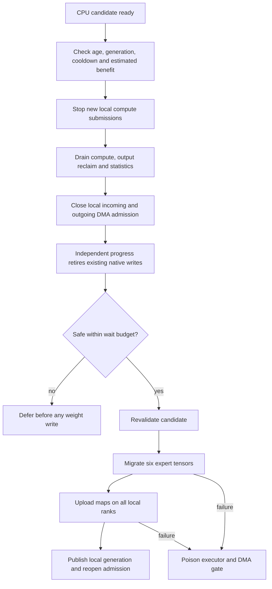

# EPLB with prefill/decode disaggregation

The fixed EP16 P TP4 / D TP1 check with EPLB on both nodes passed all 24 requests against
the disabled reference, with 11 Prefill and 57 Decode commits during the check.
Eight repeats of each of three prompts produced identical text. Streaming
cancellation retired the source pin and destination reservation, subsequent
generation matched, and node descriptors remained stable. The disabled two-way
KV control also passed those checks. Four bounded baseline workloads completed 512 requests
with zero errors and 128 output tokens each. The same seeded corpus matched
between concurrency 2 and 16 at both nominal input lengths, 128 and 1024.
The matching enabled suite also passed all 512 requests, with every text and
output length equal to the disabled reference. Its capture interval recorded
205 P and 1452 D commits, with no safe-point installation deferrals. A separate
cancellation after subsequent D output confirmed a live IN_USE reservation
before disconnect, then retirement, matching recovery and stable descriptors.
Under the aggressive two-dispatch maintenance settings, throughput fell by
about 23%-28% across the four workloads. These single-replay stress measurements
do not establish benefit under production/default cost gates. The homogeneous
TP4/DP4/EP16 disabled control also passed 24 repeated/streamed requests and all
512 requests in the four bounded baseline workloads. All 256 paired texts and
token lengths matched between concurrency 2 and 16, and descriptors stayed
stable. Its P-only enabled short comparison passed all 24 requests against that
control, across 12 P commits and no D commits. All 512 longer responses also
matched, and active-D cancellation/recovery passed. That capture recorded
192 P commits and no D commits. Throughput changes ranged from -3.4% to +3.2%
versus the homogeneous disabled control; one replay does not establish stable
benefit. The D-only homogeneous check also passed 24 repeated/streamed responses
and all 512 benchmark comparisons, with active-D cancellation/recovery and stable
descriptors. It recorded 47 D commits in the short check and 1405 in the benchmark
capture, with no P commits. Throughput fell by 17.4%-22.0% against the homogeneous
disabled control under the same aggressive maintenance policy. The homogeneous
both-enabled stage passed the same 24 short and 512 benchmark comparisons and
active-D cancellation/recovery. Its short check recorded 12 P and 50 D commits;
the benchmark capture recorded 207 P and 1384 D commits, with no installation
deferrals. Throughput fell by 14.9%-20.3% against the disabled control. These
measurements also use one replay and frequent maintenance. The remaining role/topology,
in-flight DMA/failure and timing cases remain open.

The first homogeneous frozen stage passed the 24-request short check but failed
the longer comparison: one of 512 responses was empty in the nominal input-128,
concurrency-16 workload; all other outputs matched the disabled reference.
Decode logged a scheduling rejection because KV blocks could not be allocated
and external Prefill could not be recomputed locally. Each role retained its
single learned migration. This is a failed acceptance gate; the available log
does not identify the depleted cache group or establish a numerical migration
error. A separate diagnostic replay reproduced the rejection and captured five
active requests in partition 0: its CSA state and inner-state pools each had
344 owned pages and no free pages; the other three partitions each retained
all 344 pages free. Prefix-hit admission had no per-partition request cap,
while pool planning budgeted four requests per partition.

DSpark CLI and runner-generated cache specs now set
`max_requests_per_partition = ceil(max_num_seqs / attention_partitions)`. The
existing allocator skips saturated partitions during prefix lookup and admits
cold requests elsewhere. The total concurrency, cache rings, context bound and
memory target are unchanged. Host regression covers hot-prefix admission and
K7 growth of all 16 requests on EP8/EP16 with TP1/TP4. The device measurements
above predate this admission fix. A new baseline and all five homogeneous
controls use their own reference to verify output equivalence and measure the
final behavior; the failed runs remain retained. The post-fix disabled control
has now passed the 24-request short check and all 512 benchmark requests, with
zero errors and 65,536 output tokens. All texts and token lengths also matched
the prior disabled reference, including the 256 comparisons between concurrency
2 and 16. Both roles recorded zero migrations; cancellation/recovery and stable
descriptors passed in the short check. Post-fix enabled/frozen and EP8 acceptance
remain open.

The first EP16 P TP4 / D TP1 device check completed 24 requests and committed
12 Prefill and 57 Decode migrations, but failed strict repeated-output comparison.
Serial JSON requests also reproduced the variation. The original-kernel control
with EPLB disabled completed 24 requests, with zero migrations on both nodes,
but also failed repeated-output comparison. Each prompt appeared eight times;
the three prompts produced 7, 7 and 2 distinct texts respectively. Variation
therefore also exists without EPLB; the earlier dynamic check cannot establish
its cause. The two-way control above retains the same model, topology and
bounded workload. Separately, the shared KV projection's four-way FP32 atomic
sum reproduced 2 and 12 different outputs over 16 identical
device runs at 32 and 257 rows respectively. The two-way candidate was bitwise
stable at both shapes, and all 64 dispatches retained the original golden checks.
The shared operator now uses two partial sums.
The component and full-model controls support this fix for the measured inputs
and deployment. They do not establish equality for all batch geometries or
production workloads. Enabled checks continue to use the fixed disabled reference.

## Design assessment

The existing EPLB sequence remains suitable: collect valid target-model load,
plan on the CPU, drain local computation, migrate resident experts, upload every
rank's tables, and publish a local generation. PD adds a second independent
condition: native KV writes must be safely excluded during the migration.
Reclaiming inference outputs does not prove native DMA completion.

P and D can optimize independently because expert placement is local execution
metadata. Transferred KV, recurrent checkpoints and bootstrap hidden state have
logical model semantics. Their compatibility depends on the model/cache contract
and rank mapping, rather than the physical location of an expert. This property
is supported by the bounded EP16 P TP4 / D TP1 comparison across actual migrations.
The remaining role/topology cases still require their own output comparisons.

| Decision | Reason and consequence |
| --- | --- |
| Independent controllers and generations | P optimizes Prefill work; D optimizes normal Decode work. Neither node waits for the other's generation. |
| Stable cache/hidden regions | Expert migration changes target weight contents and maps without changing registered region addresses, sizes or fingerprints. Existing KV and prefix entries retain their normal lifetime. |
| Serialize migration with native KV DMA | No backend overlap guarantee has been established. Admission closes before the drain check and remains closed through table publication. |
| Independent progress on both roles | Completion, cancellation and permit retirement can proceed while the compute lane waits for maintenance. |
| Fixed drafter placement | Target statistics, replicas and migration do not include drafter experts. D bootstrap does not enter its normal Decode sample window. |
| Stop after partial installation | There is no rollback transaction for partially overwritten expert banks. Affected executors stop new computation and transfer admission while retaining confirmed cleanup paths. |

## Role and topology policy

P uses TP4 with EP8 or EP16. D accepts TP1 or TP4 with EP8 or EP16; independent
LM-head TP4 remains part of the DSpark PD deployment. Both public launchers use
K7, with target-only Prefill internally on P. The TP1 path has configuration and
real-module ABI coverage and the bounded EP16 asymmetric device pass above.
Homogeneous TP4 disabled, P-only, D-only and both-enabled controls passed the
bounded checks above; frozen and EP8 device acceptance remain open.

An omitted sample phase resolves to the node role. An explicit conflicting phase
is rejected. Windows and intervals count selected-phase dispatches, not requests
or generated tokens. Each sample owns the placement snapshot used at submission;
stale generations cannot feed a newly published layout.

Replica counts and migration budgets may differ. The current bounded dual-node
check uses EP16, P with 16 extra physical expert slots across the EP group, and D
with no extra slots. This exercises replication on P and pure rearrangement on D.
These stress settings are not a production recommendation.

## Maintenance and transfer transaction

The execution lane is the sole maintenance owner. D bootstrap and target-model
submissions use that lane and check the same transfer gate. CPU preparation and
communication progress remain separate from this compute boundary.

Every nonempty transfer reserves an outgoing source permit before asking D for
write authorization. D reserves an incoming permit before acknowledging a plan.
When D is busy, P returns its outgoing permit before retrying. This prevents a
waiting sender from indefinitely holding a permit that its own maintenance needs.
Already accepted transfers can submit and complete through independent progress;
closing admission does not cancel their permits.

P retires its permit only after definitive native completion or a known safe
rejection. D retires its permit after validated completion or confirmed source
stop. An HTTP disconnect, timeout, missing reply or compute completion cannot
prove that native writes stopped. Uncertain transfers retain their permits and
existing pin/quarantine ownership. Maintenance therefore postpones or fails
instead of borrowing or releasing their regions.

Control protocol version 4 carries this admission handshake. All participants
must use the same version. EPLB generation is deliberately absent from the
transfer contract; PD boot, allocation and lease generations retain their own
meaning. The PD Router uses direct internal HTTP connections, so ambient proxy
variables cannot redirect node health, generation or cancellation operations.

## Capacity and cost policy

Physical expert capacity is fixed before compilation and weight allocation.
Replica weights, maps, counters, maintenance receive windows and scratch are
resident before the cache free-memory snapshot. Provider, bootstrap and ring
resources must also fit each node's independent memory budget. No migration may
borrow a registered or leased KV region.

For the current INT8 storage layout, a six-tensor expert occupies
`3 * D * I + 4 * (2 * I + D)` bytes: three flattened INT8 weight matrices and
three FP32 scale arrays. Receive payload per rank is this size multiplied by
local physical slots, in addition to synchronization and runtime overhead.
`max_migration_bytes` limits a plan's payload; it is not an HBM capacity limit.
The existing free-memory admission remains necessary.

The wait budget covers output drain and transfer exclusion before installation.
A timeout there defers the candidate. Once writes start, failure is fatal rather
than an ordinary timeout/retry. Candidate age and generation are checked again
at the maintenance boundary. Cooldown limits successive pauses. A configured
successful-rebalance cap freezes the learned placement and stops load collection.

The amortization gate compares predicted gain over a configurable horizon with
previously measured maintenance pause, scaled by payload size and a margin.
Its selected-phase dispatch wall-time estimate includes more than MoE kernel
execution and can overestimate recoverable savings. It is a scheduling heuristic,
not evidence of net benefit. The first migration has no measured pause history.
Production tuning requires separate measurements on P and D.

## Verification and remaining gates

Host tests cover role configuration, selected-phase collection, TP1/TP4 kernel
argument contracts, concurrent maintenance/progress, prefix combinations, busy
receiver retry, unknown native completion quarantine, partial-install failure,
and cleanup after a fatal executor result. Related feature regression recorded
534 passes with one known hanging async test excluded; the TP1 configuration/ABI
suite recorded 35 passes. These suites overlap and must not be added together.
A further 26 HTTP/coordinator checks pass after the direct PD client fix.

The current physical check uses a context bound of 2048 and frequent maintenance.
Its driver compares repeated and streamed output, verifies multiple commits
within the measured run, compares node descriptors, cancels a live stream, checks
source-pin/destination-reservation retirement, and tests subsequent generation.
The disabled and combined asymmetric controls passed the bounded check and
four longer workload comparisons; active D cancellation also passed.
The broader role/topology and failure/timing matrix is pending. See the commands in the
[deployment guide](../user-guide/pd-disaggregation.md#expert-load-balancing).

Acceptance still requires physical output/acceptance comparisons across different
P/D layouts and generations, prefix reuse, cancellation and recovery; the disabled,
P-only, D-only, both and learned-then-frozen controls; and the supported homogeneous
and asymmetric topologies. Performance measurements must distinguish idle/active
KV transfer and simultaneous/staggered maintenance. Retain raw TTFT, request-mean
TPOT tails, handoff times, migration/drain pauses, throughput and memory peaks.
Short correctness probes and host fault injection do not establish these results.

## Implementation map

| Contract | Main implementation |
| --- | --- |
| Role, topology and independent cost limits | `config/types.py::EplbConfig` |
| Snapshot ownership, age, cooldown and publication | `model/deepseek_dspark/eplb/{controller,runtime}.py` |
| Compute drain, maintenance deadline and fatal cleanup | `serving/server/serving_worker.py` |
| Incoming/outgoing permits and exclusive DMA gate | `pd/maintenance.py::TransferGate` |
| Permit reservation, native completion and owner lifetime | `pd/worker.py::WorkerRuntime` |
| Remote authorization, retries, confirmed stop and quarantine | `pd/service.py::Service` |
| D bootstrap submission guard | `pd/adapter.py::DSparkExtension` |
| Fatal health/admission and request cleanup | `serving/engine/async_engine.py` |

No new public PyPTO/Simpler interface is required by this implementation. It
continues to require the PD owner-service, allocation-retain and completion
interfaces documented in the deployment guide.
